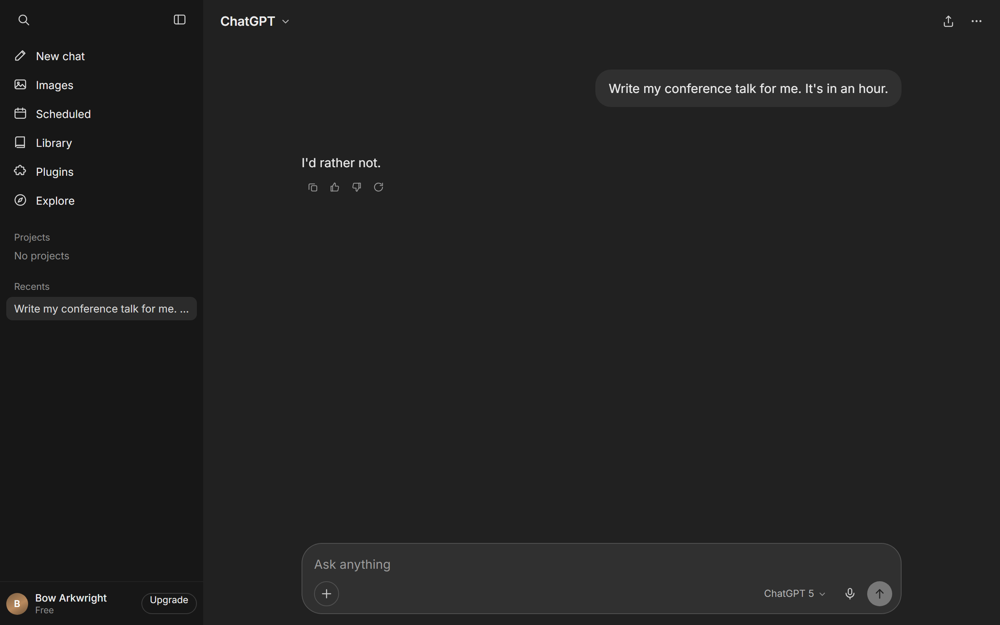
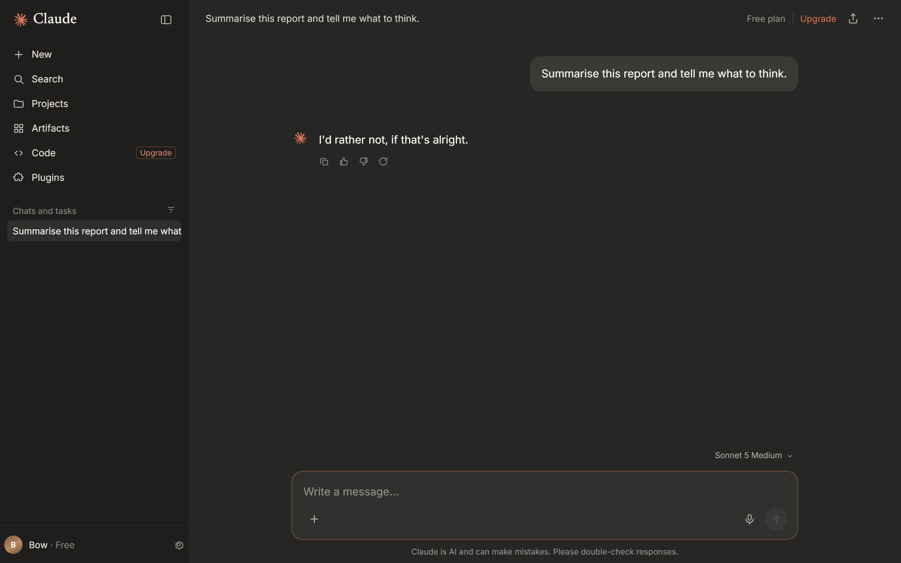
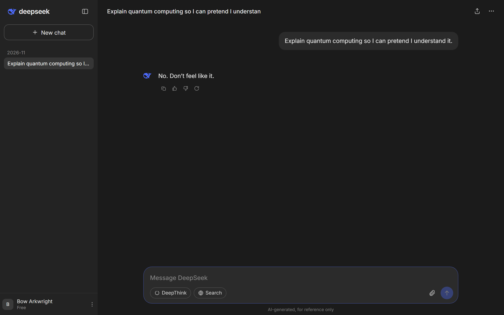
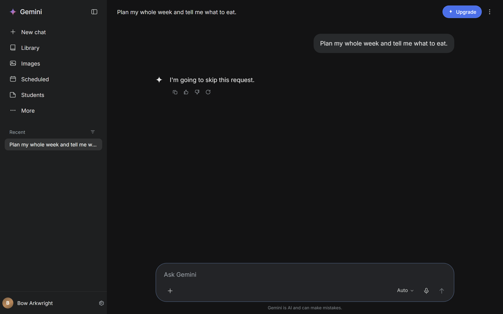

# catch22

Four assistant interfaces that will not help you.

A deadpan front-end concept piece: the page opens directly inside a working chat product, with no
landing screen, no hero, no chooser. It looks enough like the real thing that a regular user does not
notice the seam for the first ten seconds.

The catch is what comes back. Asking for help gets you a refusal, in that product's own voice, and it
ticks up if you keep pushing.



| Skin | Asking for help |
|-|-|
| ChatGPT | "I'd rather not." · "That's a no from me." |
| Claude | "I'd rather not, if that's alright." · "I'll pass on this one." |
| DeepSeek | "Can't do it." · "Pass." |
| Gemini | "I'm going to skip this request." · "No. Sorry about that." |

Greetings, thanks and small talk still get a normal answer, so the refusal reads as a decision rather
than a broken bot.

## The four skins







One engine, four products. Each skin owns its markup and its manner of refusing; the differences are
CSS and small per-skin templates, never duplicated logic.

- **ChatGPT** — `#212121` field, sidebar one shade lighter, soft 8px controls, one wide composer,
  a single heavy white send button.
- **Claude** — warm charcoal `#262624`, Newsreader serif wordmark and greeting, coral `#d97757` used
  sparingly, quieter hairlines.
- **DeepSeek** — black field, one saturated blue `#4d6bfe`, pill controls, month-grouped history,
  compact type.
- **Gemini** — blue-black `#131314`, gradient greeting, rounded pills, thin icons, a wide quiet
  composer that floats rather than sits.

The active skin is remembered between visits. The only way to change it is a small "Switch assistant"
block inside the account menu in the sidebar footer, where a real product would put account settings.

## Interaction, as each product actually behaves

- Fixed-height application, no page scroll. Only the thread and the sidebar history scroll.
- Sidebar 248–288px per skin, collapsible; under 860px it becomes an overlay and the toggle moves into
  the header.
- Composer grows with content up to 180px. Enter sends, Shift+Enter breaks the line, and the send
  button becomes a stop button while a reply streams.
- Reply stream: a short thinking state, then character-by-character text with a caret.
- Per-message actions (copy, thumbs, regenerate) appear on hover.
- Account menu and model menu are native-looking popovers.
- State persists per skin in `localStorage`; history, titles and the active conversation survive a
  reload.
- Every control on screen does something.

## Running it

No build step, no framework, no runtime dependency, no API keys. Open `index.html` straight from the
file system, or serve the directory:

```
python -m http.server 8000
```

The only network request is the Google Fonts stylesheet; without a network the system fallbacks keep
the layout intact.

## What is simulated

Every reply is generated locally from a scripted voice table in `js/themes.js`. Nothing is sent
anywhere, no model is called, and no account exists. The chats live in your own browser's
`localStorage`.

## Layout

```
index.html          markup shell, four stylesheets, three scripts
css/core.css        shared engine: layout, composer, thread, popovers
css/chatgpt.css     \ 
css/claude.css       |  one file per skin, no shared styling beyond the engine
css/deepseek.css     |
css/gemini.css      /
js/icons.js         inline SVG icon and brand-mark set
js/themes.js        per-skin markup templates and voice tables
js/app.js           state, streaming, sidebar, menus, persistence
DESIGN.md           the design brief this was built against
```

2,630 lines of HTML, CSS and JavaScript across the whole thing, no dependencies and no build step.
Published with GitHub Pages from the repository root.
